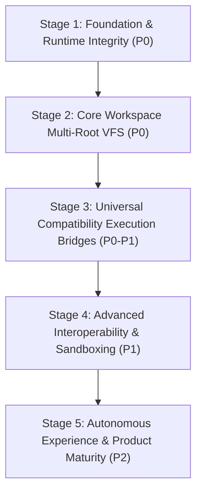

# Prioritized Engineering Roadmap

**Repository**: `open_code`  
**Date**: October 31, 2026  
**Auditor**: Antigravity Technical Pair Programmer  

This roadmap outlines the sequenced development path to transform the `open_code` baseline into an autonomous agent platform with Antigravity 2.0 functional parity and universal ecosystem compatibility.

---

## 1. Stage Sequence & Dependency Rationale

The development stages are structured to respect strict runtime dependencies:

### Dependency Logic:
1. **Stage 1 (Foundation)** ensures continuous build stability, typecheck purity, and baseline regression safety.
2. **Stage 2 (Core Workspace VFS)** must precede Stage 3 because external skills and rules depend on file tools being able to resolve files across all attached secondary roots.
3. **Stage 3 (Universal Compatibility Bridges)** connects the existing parsers directly into the live agent prompt and MCP daemon.
4. **Stage 4 (Interoperability & Sandboxing)** introduces secure runtime boundaries for foreign plugin execution and Antigravity script execution.
5. **Stage 5 (Autonomous Experience)** delivers Antigravity 2.0 capabilities (reactive wakeup, background tasks, sidecars, and distribution packaging).

---

## 2. Stage-by-Stage Task Breakdown

### Stage 1 — Foundation & Runtime Integrity

#### Task 1.1: Git Safety & Auxiliary Remote Cleanup
- **Priority**: P0 (Immediate)
- **Current State**: Auxiliary remote `opencode` points to local directory `c:\Users\gaumi\Documents\GitHub\opencode`.
- **Required Work**: Remove local upstream remote `opencode` or configure strict push-blocking to prevent accidental upstream pushes.
- **Dependencies**: None.
- **Relevant Files**: `.git/config`
- **Acceptance Criteria**: Only `origin` (`https://github.com/Beastknight933/open_code.git`) is configured for push.
- **Tests Required**: `git remote -v` verification.

#### Task 1.2: Continuous Regression Guard & Pre-Push Hook
- **Priority**: P0
- **Current State**: `.husky/pre-push` exists; monorepo typecheck is passing.
- **Required Work**: Ensure Husky pre-push hook runs fast typecheck and core tests before any local commit/push.
- **Dependencies**: Task 1.1.
- **Relevant Files**: `.husky/pre-push`, `package.json`
- **Acceptance Criteria**: Attempts to push invalid code are rejected automatically at the Git boundary.
- **Tests Required**: Verification with intentional dummy commit failure.

---

### Stage 2 — Core Platform Capabilities & Multi-Root VFS

#### Task 2.1: Multi-Root Workspace VFS Path Resolution in File Tools
- **Priority**: P0 (Critical Path)
- **Current State**: `MultiFolderWorkspace` manages secondary roots in `.opencode/workspace.json`, but native file tools (`read`, `write`, `edit`, `patch`, `glob`, `grep`) only resolve against `location.directory`.
- **Required Work**:
  1. Update [`packages/core/src/file-access.ts`](file:///c:/Users/gaumi/Documents/GitHub/open_code/packages/core/src/file-access.ts) and [`packages/core/src/filesystem/search.ts`](file:///c:/Users/gaumi/Documents/GitHub/open_code/packages/core/src/filesystem/search.ts) to consult `MultiFolderWorkspace.listFolders(projectID)`.
  2. Implement fallback path resolution: if a relative path is not found in the primary root, resolve across secondary attached folders in added order.
  3. Update `glob` and `grep` tools to search across all attached workspace roots when requested.
- **Dependencies**: Stage 1.
- **Relevant Files**:
  - `packages/core/src/file-access.ts`
  - `packages/core/src/tool/plugin/read.ts`
  - `packages/core/src/tool/plugin/write.ts`
  - `packages/core/src/filesystem/search.ts`
- **Acceptance Criteria**: Agent calling `read_file` or `grep` with relative paths targeting files in an attached secondary directory succeeds without requiring manual absolute paths.
- **Tests Required**: Integration test in `packages/core/test/workspace-manager/multi-folder-vfs.test.ts`.

#### Task 2.2: Project Attachments Vector/Context Enrichment
- **Priority**: P1
- **Current State**: Text summaries are generated via line slicing; full-text search is substring matching.
- **Required Work**:
  1. Enhance [`packages/core/src/workspace-manager/attachments.ts`](file:///c:/Users/gaumi/Documents/GitHub/open_code/packages/core/src/workspace-manager/attachments.ts) with semantic chunking for markdown and code attachments.
  2. Integrate project attachments into the agent's initial prompt context when relevant to the user query.
- **Dependencies**: Task 2.1.
- **Relevant Files**: `packages/core/src/workspace-manager/attachments.ts`, `packages/core/src/session/prompt.ts`
- **Acceptance Criteria**: Uploaded project specifications are referenced by the agent when answering architectural questions.
- **Tests Required**: Unit tests verifying chunking and prompt context inclusion.

---

### Stage 3 — Universal Compatibility Execution Bridges

#### Task 3.1: MCP Live Runtime Registration & Persistence
- **Priority**: P0 (Critical Path)
- **Current State**: `UniversalMcpManager` translates Claude/Cursor configs and tests servers, but `/api/extension/install` only records CIR into `ExtensionRegistry`, leaving `ConfigMcpPlugin` unchanged.
- **Required Work**:
  1. In [`packages/server/src/handlers/extension.ts`](file:///c:/Users/gaumi/Documents/GitHub/open_code/packages/server/src/handlers/extension.ts), when an MCP server is installed, write the server config directly into the project's active `opencode.json` (or `.opencode/mcp.json`).
  2. Trigger dynamic reload of OpenCode's native `Mcp.Service` so the newly installed server boots and registers its tools in the active session.
- **Dependencies**: Stage 1.
- **Relevant Files**:
  - `packages/server/src/handlers/extension.ts`
  - `packages/core/src/config/plugin/mcp.ts`
  - `packages/core/src/mcp/index.ts`
- **Acceptance Criteria**: Importing a `claude_desktop_config.json` immediately boots the MCP server process; its tools appear in the agent tool registry and are callable in chat.
- **Tests Required**: End-to-end test with a local STDIO echo MCP server in `packages/core/test/extension/mcp-runtime.test.ts`.

#### Task 3.2: Rules Prompt Injection Pipeline
- **Priority**: P0 (Critical Path)
- **Current State**: `RulesAdapter` parses `.cursorrules`, `CLAUDE.md`, and `.mdc` files, but `ConfigInstructionPlugin` exclusively looks for `AGENTS.md`.
- **Required Work**:
  1. Update [`packages/core/src/config/plugin/instruction.ts`](file:///c:/Users/gaumi/Documents/GitHub/open_code/packages/core/src/config/plugin/instruction.ts) and [`packages/core/src/instruction-discovery.ts`](file:///c:/Users/gaumi/Documents/GitHub/open_code/packages/core/src/instruction-discovery.ts) to discover `CLAUDE.md`, `.cursorrules`, and `.cursor/rules/*.mdc`.
  2. Use `RulesAdapter.formatInstructionsForPrompt` to merge external rules according to precedence and file-glob match criteria.
  3. Include merged rules in the system prompt delivered to the LLM.
- **Dependencies**: Stage 1.
- **Relevant Files**:
  - `packages/core/src/config/plugin/instruction.ts`
  - `packages/core/src/instruction-discovery.ts`
  - `packages/core/src/extension/rules/adapter.ts`
  - `packages/core/src/session/runner/llm.ts`
- **Acceptance Criteria**: In a workspace with a `CLAUDE.md` or `.cursorrules` file, the model prompt contains the rules without requiring manual conversion to `AGENTS.md`.
- **Tests Required**: Prompt generation test in `packages/core/test/extension/rules-injection.test.ts`.

#### Task 3.3: Direct Authenticated GitHub Ingestion
- **Priority**: P1
- **Current State**: `packages/core/src/extension/github.ts` executes local `git clone`.
- **Required Work**: Implement authenticated GitHub REST API tarball extraction and tree fetching with PAT credential support.
- **Dependencies**: Stage 1.
- **Relevant Files**: `packages/core/src/extension/github.ts`, `packages/schema/src/extension.ts`
- **Acceptance Criteria**: Ingesting skills or repositories from private GitHub URLs succeeds using configured GitHub tokens.
- **Tests Required**: Ingestion mock tests with auth headers.

---

### Stage 4 — Advanced Interoperability & Sandboxing

#### Task 4.1: Antigravity Multi-Directory Skill Script Runner
- **Priority**: P1
- **Current State**: Nested `scripts/` are copied to `.opencode/skills/<id>/scripts/`, but the agent must formulate manual bash commands to invoke them.
- **Required Work**:
  1. Enhance [`packages/core/src/tool/plugin/skill.ts`](file:///c:/Users/gaumi/Documents/GitHub/open_code/packages/core/src/tool/plugin/skill.ts) to parse available scripts in `scripts/`.
  2. Expose an explicit execution subcommand or helper tool that runs the skill script in an isolated shell environment with bound workspace parameters.
- **Dependencies**: Task 2.1, Task 3.2.
- **Relevant Files**: `packages/core/src/tool/plugin/skill.ts`, `packages/core/src/extension/skills/adapter.ts`
- **Acceptance Criteria**: Agent invoking an Antigravity skill can execute its helper scripts without guessing the on-disk storage path.
- **Tests Required**: Skill script execution test fixture.

#### Task 4.2: Foreign Plugin Sandboxed Execution Host
- **Priority**: P1
- **Current State**: `PluginAdapter` synthesizes JS shim templates, but no execution sandbox exists.
- **Required Work**:
  1. Design an isolated process worker (`packages/core/src/extension/plugin/sandbox-host.ts`) utilizing Node `worker_threads` or isolated child process.
  2. Implement an RPC bridge between the worker and OpenCode's tool execution API.
  3. Enforce `ExtensionSecurity.Permissions` (restricting filesystem and network to declared scopes).
- **Dependencies**: Task 3.1, Task 4.1.
- **Relevant Files**: `packages/core/src/extension/plugin/adapter.ts`, `packages/core/src/extension/plugin/sandbox.ts`
- **Acceptance Criteria**: Foreign plugin shims execute in a sandboxed worker without direct access to the host server's process memory.
- **Tests Required**: Sandbox containment test and permission violation trap tests.

---

### Stage 5 — Autonomous Experience & Product Maturity

#### Task 5.1: Reactive Background Wakeup Loop
- **Priority**: P2
- **Current State**: `SessionExecution` and `SessionRunCoordinator` manage process drains, but background processes do not trigger proactive wakeups.
- **Required Work**: Wire background task completion events into `Bus.Service` and `SessionExecution.wake(sessionID)` so long-running tasks wake the agent upon completion without polling.
- **Dependencies**: Stage 1.
- **Relevant Files**: `packages/core/src/session/execution.ts`, `packages/core/src/bus.ts`
- **Acceptance Criteria**: Agent initiates a background command, yields turn, and is automatically re-invoked when the background command completes.
- **Tests Required**: Reactive wakeup test fixture.

#### Task 5.2: Autonomous Slash Command State Machines (`/goal`, `/plan`)
- **Priority**: P2
- **Current State**: Command files exist as markdown instructions.
- **Required Work**: Implement persistent goal state machines that track multi-step milestone completion and continue autonomous iteration until completion.
- **Dependencies**: Task 5.1.
- **Relevant Files**: `packages/core/src/goal.ts`, `packages/core/src/plan.ts`
- **Acceptance Criteria**: Running `/goal` drives multi-step problem solving across multiple tool calls without stalling.
- **Tests Required**: Autonomous simulation test in `packages/simulation`.

#### Task 5.3: Interactive Sidecar Host Architecture
- **Priority**: P2
- **Current State**: Sidecars do not exist in desktop/web UI.
- **Required Work**: Implement an extensible sidecar protocol in `packages/desktop` and `packages/app` allowing web tools, 3D viewers (Mol*), and mobile preview devices to dock beside the conversation.
- **Dependencies**: Stage 4.
- **Relevant Files**: `packages/app/src/`, `packages/desktop/src/main/`
- **Acceptance Criteria**: Sidecar links in chat open interactive panels in the desktop UI.
- **Tests Required**: Sidecar lifecycle tests in `packages/desktop`.

#### Task 5.4: Production Packaging & Release Compilation
- **Priority**: P2
- **Current State**: `electron-builder` configuration passes tests, but `dist/` is empty.
- **Required Work**: Execute the full build pipeline (`bunx electron-vite build`, `bunx electron-builder`) to produce tested Windows `.exe` installers, macOS bundles, and standalone CLI binaries.
- **Dependencies**: All prior stages.
- **Relevant Files**: `packages/desktop/electron-builder.json`, `packages/cli/`
- **Acceptance Criteria**: Standalone `OpenCode Dev.exe` launches cleanly on Windows and CLI binary executes standalone.
- **Tests Required**: Verification of binary launch and smoke tests.
