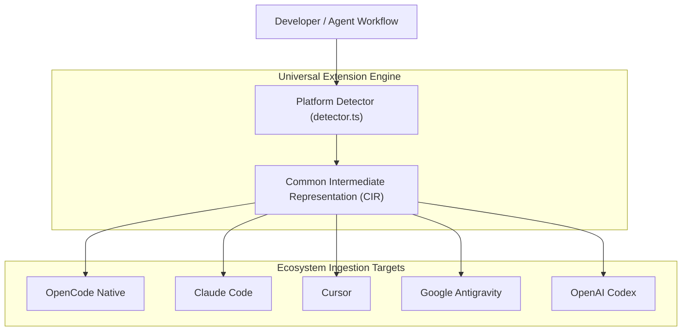

# Universal Agent Compatibility Matrix

**Repository**: `open_code`  
**Audit Date**: October 31, 2026  
**Auditor**: Antigravity Technical Pair Programmer  

This audit evaluates the cross-platform interoperability of `open_code` across five major agent ecosystems: **OpenCode**, **Anthropic Claude Code**, **Cursor**, **Google Antigravity**, and **OpenAI Codex**.

---

## 1. High-Level Ecosystem Support Overview



| Ecosystem | Skills Support | MCP Support | Rules / Instructions Support | Plugin Support | Overall Runtime Status |
| :--- | :--- | :--- | :--- | :--- | :--- |
| **OpenCode** | **NATIVE** | **NATIVE** | **NATIVE** | **NATIVE** | Fully Operational |
| **Claude Code** | **CONVERTED** | **CONVERTED** | **CONVERTED** (Static) | **PROTOTYPE SHIM** | Metadata imported; MCP/Rules need runtime hook |
| **Cursor** | **CONVERTED** | **CONVERTED** | **CONVERTED** (Static) | **PROTOTYPE SHIM** | Configs imported; rules need prompt injection |
| **Google Antigravity**| **ADAPTED** | **NATIVE** (Standard) | **ADAPTED** | **PROTOTYPE SHIM** | Multi-dir skills ingested; sidecars & shims missing |
| **OpenAI Codex** | **CONVERTED** | **NATIVE** (Via tools) | **ADAPTED** | **PROTOTYPE SHIM** | Manifests detected; execution uses shell/tool bridges |

---

## 2. In-Depth Platform Analysis

### 2.1 Native OpenCode
- **Skills**: Native discovery via `ConfigSkillPlugin` from `.opencode/skills/`. Full execution supported via `SkillTool`.
- **MCP**: Native client implementation supporting STDIO, HTTP, SSE, and OAuth transports in `packages/core/src/mcp/`.
- **Rules**: Discovers `AGENTS.md` up the directory tree in `ConfigInstructionPlugin`.
- **Plugins**: Native Effect-TS plugin host architecture in `packages/plugin/` and `packages/core/src/plugin/`.
- **Execution Reality**: **100% Native & Operational**.

---

### 2.2 Anthropic Claude Code
- **Skills**: Claude skills follow markdown prompt conventions. `SkillAdapter` parses and normalizes them into OpenCode `SKILL.md` format.
- **MCP Configuration**:
  - *Implemented*: `UniversalMcpManager.importClaudeDesktopConfig` converts `claude_desktop_config.json` (`mcpServers` dictionary) into OpenCode's `Mcp.LocalConfig` and `Mcp.RemoteConfig` structures.
  - *Execution Reality*: Converted in memory and testable via diagnostics (`testServer`), but not yet automatically written to active `opencode.json` on install.
- **Rules / Instructions**:
  - *Implemented*: `RulesAdapter.parseClaudeMd` reads `CLAUDE.md` guidelines and formats them with standard priority.
  - *Execution Reality*: Parsed and visible in Settings UI, but `ConfigInstructionPlugin` does not yet inject `CLAUDE.md` into the agent's prompt during live steps.
- **Plugins / Tools**:
  - *Implemented*: Foreign tool mapping translates `claude.tools.bash` -> `shell`, `claude.tools.edit` -> `edit`, `claude.tools.view` -> `read`.
  - *Execution Reality*: Tool mappings exist as declarative translation rules; native tool execution occurs if routed through OpenCode tools.

---

### 2.3 Cursor
- **Skills / MDC Files**:
  - *Implemented*: `RulesAdapter.parseCursorMdc` parses Cursor `.mdc` files and `.cursorrules`. Extracts frontmatter `globs`, `description`, and `alwaysApply`.
  - *Execution Reality*: Parsed and sorted by precedence. However, dynamic evaluation against edited files during prompt building requires integration into the turn execution pipeline.
- **MCP Configuration**:
  - *Implemented*: `UniversalMcpManager.importCursorConfig` parses Cursor MCP server definitions (stdio commands and URLs) into `Mcp.ServerConfig`.
  - *Execution Reality*: Schema conversion verified; runtime persistence gap matches Claude Code.
- **Plugins / Extensions**:
  - *Implemented*: Capability mappings exist for `vscode.workspace.fs` -> OpenCode `read`/`write`.
  - *Execution Reality*: VS Code extension execution is unsupported (by design); declarative adapter proposals indicate unsupported features honestly.

---

### 2.4 Google Antigravity (AGY)
- **Skills & Workflows**:
  - *Implemented*: `ExtensionDetector` detects Antigravity skills with multi-directory structures (`scripts/`, `references/`, `resources/`, `SKILL.md`). `SkillAdapter` preserves the full folder hierarchy during installation into `.opencode/skills/<id>/`.
  - *Execution Reality*: Skills are discovered by OpenCode's scanner. However, runtime execution of helper scripts in `scripts/` relies on the agent executing shell commands against the destination path, rather than a sandboxed script runner.
- **Rules & Instructions**:
  - *Implemented*: `RulesAdapter` parses Antigravity rules and XML-wrapped instructions.
- **Plugins & Sidecars**:
  - *Implemented*: `PluginAdapter` inspects `plugin.json` / `.gemini` manifests and synthesizes `generateAntigravityShim`.
  - *Execution Reality*: **Metadata & Shim Generation only**. Antigravity UI sidecars (e.g. 3D viewers, device hubs) and custom hooks are currently unsupported; the shim code is not executed in an active runtime sandbox.

---

### 2.5 OpenAI Codex
- **Skills**: Codex prompt instruction templates are parsed by `SkillAdapter` into OpenCode skills.
- **MCP / Tools**: Codex bash and file search tools map directly to OpenCode `shell` and `grep` tools via `AdapterGenerator`.
- **Manifests**: `ExtensionDetector` identifies `codex.json` and `.codex/` directory markers.
- **Execution Reality**: **Converted Configuration**. Operational to the extent that instructions run through standard OpenCode tools.

---

## 3. Security, Permissions & Sandboxing Status

| Capability | Status | Implementation Mechanism | Security Guarantee |
| :--- | :--- | :--- | :--- |
| **Path Traversal / Zip-Slip** | **ENFORCED** | `ExtensionSecurity.isPathSafe` | Normalizes paths, blocks null-bytes, rejects `..` climbing outside destination root. |
| **Destructive Command Guard** | **ENFORCED** | `ExtensionSecurity.scanContent` | Rejects `rm -rf`, `mkfs`, format patterns before installation. |
| **Secret Token Exposure** | **ENFORCED** | `ExtensionSecurity.scanContent` | Flags hardcoded OpenAI, GitHub tokens and RSA private keys. |
| **Tool Execution Gating** | **ENFORCED** | `packages/core/src/permission.ts` | Host dialog prompts user for tool authorization (`ask`, `allow`, `deny`). |
| **Untrusted Code Sandbox** | **MISSING** | None (direct Node/Bun execution) | Foreign scripts execute in local user process environment without OS sandbox or container boundary. |
| **Credential Storage Isolation**| **ENFORCED** | SQLite `CredentialTable` | Model credentials stored separately from project workspace directories. |

---

## 4. Execution vs. Metadata Summary

```
Ecosystem Capabilities Ingestion:
[==================================================] 100% (Detection & Schema Parsing)

Ecosystem UI Management & Inspection:
[==================================================] 100% (6-Tab Customization Center)

Ecosystem File Extraction & Placement:
[==================================================] 100% (Directory Preservation)

Ecosystem Active Runtime Execution:
[========================                          ]  48% (Gaps in MCP Persistence, Rules Hook & Plugin VM)
```
