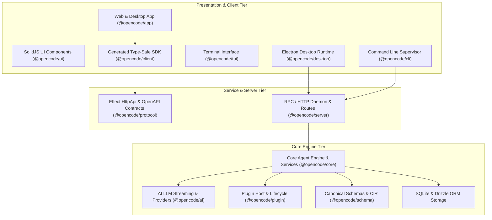
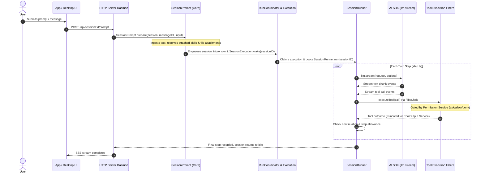
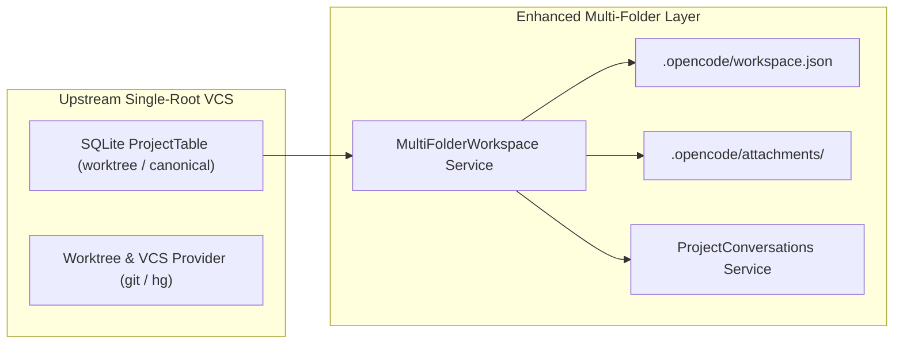

# Repository Architecture Audit

**Repository**: `open_code` (Independent Fork of OpenCode)  
**Baseline Version**: Upstream `v2.2.4` (`origin/dev` tracking commit `2e29481d5c5b92b75b6a29eeca8a8ff8ed166af7`)  
**Current Head**: `f5ffcb524acecad6042f901e3d98550c8c11e4ee` on branch `main`  
**Date**: October 31, 2026  
**Auditor**: Antigravity Technical Pair Programmer  

---

## 1. System Overview & Monorepo Structure

The `open_code` platform is an independently maintained, TypeScript-first agent development platform built on top of OpenCode. It is organized as a Turborepo monorepo managed by Bun `v1.4.4` containing 40 workspaces across three primary tiers:

### 1.1 Dependency Direction Rules
As enforced by the repository architecture and `AGENTS.md`:
- `@opencode/schema` is the leaf schema contract layer.
- `@opencode/protocol` defines public HttpApi endpoints referencing `@opencode/schema`.
- `@opencode/client` is automatically generated from `@opencode/protocol` using `@opencode/httpapi-codegen`.
- `@opencode/core` implements business logic, session orchestration, and SQLite queries. Client runtime code never depends on Core or Server.
- `@opencode/server` hosts the HTTP daemon and maps Protocol endpoints to Core service implementations.

---

## 2. Core Agent Execution Flow

The core agent execution loop preserves OpenCode's decoupled event-sourced model. Execution flows through durable inbox admission, process coordination, and explicit LLM streaming steps:

### Verified Code Paths:
- **Prompt Admission**: [`packages/core/src/session/prompt.ts`](file:///c:/Users/gaumi/Documents/GitHub/open_code/packages/core/src/session/prompt.ts#L34-L70). Prompts are materialized, attachments processed, and enqueued into `session_inbox` table.
- **Run Coordination**: [`packages/core/src/session/run-coordinator.ts`](file:///c:/Users/gaumi/Documents/GitHub/open_code/packages/core/src/session/run-coordinator.ts) and [`packages/core/src/session/execution.ts`](file:///c:/Users/gaumi/Documents/GitHub/open_code/packages/core/src/session/execution.ts#L54-L120). Coordinates process-local session ownership and coalesces prompt wakeups.
- **Step Execution Loop**: [`packages/core/src/session/runner/step.ts`](file:///c:/Users/gaumi/Documents/GitHub/open_code/packages/core/src/session/runner/step.ts#L71-L150). Each step initiates an explicit `llm.stream(...)` call. Tool calls are intercepted, run as supervised fibers, and bounded by step budgets.

---

## 3. Model & Provider Integrations

- **LLM Streaming Engine**: Implemented in [`packages/ai/src/llm.ts`](file:///c:/Users/gaumi/Documents/GitHub/open_code/packages/ai/src/llm.ts). Provides structured output via schema, token counting, tool call formatting, and provider normalization.
- **Provider Implementations**: Located in [`packages/ai/src/providers/`](file:///c:/Users/gaumi/Documents/GitHub/open_code/packages/ai/src/providers/). Over 30 native provider adapters exist, including Anthropic, OpenAI, Google Interactions / Gemini, AWS Bedrock Converse, Azure OpenAI, Groq, Mistral, Ollama, DeepSeek, and OpenRouter.
- **Model Resolution**: Managed by [`packages/core/src/model-resolver.ts`](file:///c:/Users/gaumi/Documents/GitHub/open_code/packages/core/src/model-resolver.ts) and [`packages/core/src/provider.ts`](file:///c:/Users/gaumi/Documents/GitHub/open_code/packages/core/src/provider.ts), resolving user model strings to active credentials stored in SQLite.

---

## 4. Tool Execution & Permission Host

- **Tool Registration**: Registered as Effect services in [`packages/core/src/plugin/internal.ts`](file:///c:/Users/gaumi/Documents/GitHub/open_code/packages/core/src/plugin/internal.ts#L270-L285). Native tools include `read`, `write`, `edit`, `patch`, `shell`, `skill`, `subagent`, `todo`, `websearch`, `webfetch`, and the three extension tools (`project_attachment`, `workspace_folder`, `universal_extension`).
- **Permission Checking**: Defined in [`packages/core/src/permission.ts`](file:///c:/Users/gaumi/Documents/GitHub/open_code/packages/core/src/permission.ts). Enforces interactive approval boundaries (`ask`, `allow`, `deny`) before any tool executing destructive filesystem operations or shell commands is permitted to run.
- **Pre-Execution Threat Detection**: Augmented by [`packages/core/src/extension/security.ts`](file:///c:/Users/gaumi/Documents/GitHub/open_code/packages/core/src/extension/security.ts) which runs AST and regex pattern scanning over imported scripts and extensions.

---

## 5. MCP Architecture

- **Native Core MCP**: Implemented in [`packages/core/src/mcp/`](file:///c:/Users/gaumi/Documents/GitHub/open_code/packages/core/src/mcp/). Supports:
  - STDIO transport: [`packages/core/src/mcp/stdio.ts`](file:///c:/Users/gaumi/Documents/GitHub/open_code/packages/core/src/mcp/stdio.ts)
  - HTTP / SSE transport: [`packages/core/src/mcp/socket-client.ts`](file:///c:/Users/gaumi/Documents/GitHub/open_code/packages/core/src/mcp/socket-client.ts)
  - OAuth negotiation: [`packages/core/src/mcp/oauth.ts`](file:///c:/Users/gaumi/Documents/GitHub/open_code/packages/core/src/mcp/oauth.ts)
  - Client tool and resource discovery: [`packages/core/src/mcp/client.ts`](file:///c:/Users/gaumi/Documents/GitHub/open_code/packages/core/src/mcp/client.ts)
- **Universal Extension MCP Subsystem**:
  - Importer & Diagnostics: [`packages/core/src/extension/mcp/manager.ts`](file:///c:/Users/gaumi/Documents/GitHub/open_code/packages/core/src/extension/mcp/manager.ts). Ingests Claude Desktop and Cursor configs, tests process availability, measures ping latency, and validates tool schemas.

---

## 6. Skills & Rules Systems

- **Upstream Skills Engine**: Discovers skills from `.opencode/skills/` via [`packages/core/src/config/plugin/skill.ts`](file:///c:/Users/gaumi/Documents/GitHub/open_code/packages/core/src/config/plugin/skill.ts) and executes them via [`packages/core/src/tool/plugin/skill.ts`](file:///c:/Users/gaumi/Documents/GitHub/open_code/packages/core/src/tool/plugin/skill.ts).
- **Universal Skill Adapter**: [`packages/core/src/extension/skills/adapter.ts`](file:///c:/Users/gaumi/Documents/GitHub/open_code/packages/core/src/extension/skills/adapter.ts). Parses `SKILL.md` frontmatter, extracts supporting files (`scripts/`, `references/`, `resources/`), and installs them into project or global skills directories.
- **Rules Ingestion Engine**: [`packages/core/src/extension/rules/adapter.ts`](file:///c:/Users/gaumi/Documents/GitHub/open_code/packages/core/src/extension/rules/adapter.ts). Parses `AGENTS.md`, `CLAUDE.md`, `.cursorrules`, and `.cursor/rules/*.mdc`. Handles glob evaluation and precedence ordering.
- **Upstream Instruction Discovery**: [`packages/core/src/instruction-discovery.ts`](file:///c:/Users/gaumi/Documents/GitHub/open_code/packages/core/src/instruction-discovery.ts) and [`packages/core/src/config/plugin/instruction.ts`](file:///c:/Users/gaumi/Documents/GitHub/open_code/packages/core/src/config/plugin/instruction.ts). Searches up the directory tree exclusively for `AGENTS.md`.

---

## 7. Workspace & Project Management Subsystem

The workspace tier comprises two cooperating layers:

1. **Multi-Folder Manager**: [`packages/core/src/workspace-manager/multi-folder.ts`](file:///c:/Users/gaumi/Documents/GitHub/open_code/packages/core/src/workspace-manager/multi-folder.ts). Allows attaching secondary root directories located across independent drives. Maintains state in `.opencode/workspace.json`. Generates unified directory trees.
2. **Project Lifecycle Operations**: [`packages/core/src/workspace-manager/project.ts`](file:///c:/Users/gaumi/Documents/GitHub/open_code/packages/core/src/workspace-manager/project.ts). Implements safe project creation, renaming, archiving, restoring, and non-destructive deletion.
3. **Project Attachments**: [`packages/core/src/workspace-manager/attachments.ts`](file:///c:/Users/gaumi/Documents/GitHub/open_code/packages/core/src/workspace-manager/attachments.ts). Persists files in `.opencode/attachments/`, computes MIME types, extracts summaries, and indexes content for search.
4. **Project Conversations**: [`packages/core/src/workspace-manager/conversations.ts`](file:///c:/Users/gaumi/Documents/GitHub/open_code/packages/core/src/workspace-manager/conversations.ts). Multi-session manager per project querying SQLite `SessionTable` by `project_id`.

---

## 8. Persistence & Configuration Architecture

- **SQLite Database**: Managed by [`packages/core/src/database/database.ts`](file:///c:/Users/gaumi/Documents/GitHub/open_code/packages/core/src/database/database.ts) using Drizzle ORM. Stores sessions, session messages, prompt inboxes, project metadata, and credentials.
- **Filesystem Project Metadata**: Stored under `<primaryRoot>/.opencode/`:
  - `workspace.json`: Attached secondary folders.
  - `extensions.json`: Universal extensions registry.
  - `attachments/`: Uploaded project documents, data files, and summaries.
  - `skills/`: Installed agent skills.
- **Fork Data Isolation**: Defined in [`packages/core/src/workspace-manager/config-migration.ts`](file:///c:/Users/gaumi/Documents/GitHub/open_code/packages/core/src/workspace-manager/config-migration.ts). Isolate the enhanced fork's user configurations into `~/.config/opencode-enhanced`, avoiding collisions with upstream OpenCode installations.

---

## 9. Frontend & Desktop Architecture

- **SolidJS Frontend**: Located in `packages/app`. Employs `@tanstack/solid-query` for reactive server state caching.
- **Settings Shell Integration**: Located in [`packages/app/src/settings/shell.tsx`](file:///c:/Users/gaumi/Documents/GitHub/open_code/packages/app/src/settings/shell.tsx). Houses the project management subviews:
  - `ProjectSettingsFolders` ([`project-folders.tsx`](file:///c:/Users/gaumi/Documents/GitHub/open_code/packages/app/src/settings/workspaces/project-folders.tsx))
  - `ProjectSettingsAttachments` ([`project-attachments.tsx`](file:///c:/Users/gaumi/Documents/GitHub/open_code/packages/app/src/settings/workspaces/project-attachments.tsx))
  - `ProjectSettingsExtensions` ([`project-extensions.tsx`](file:///c:/Users/gaumi/Documents/GitHub/open_code/packages/app/src/settings/workspaces/project-extensions.tsx))
- **Desktop Electron Main Process**: Located in `packages/desktop/src/main/`. Handles native window management, protocol registration, local daemon supervision, and secure IPC communication.
